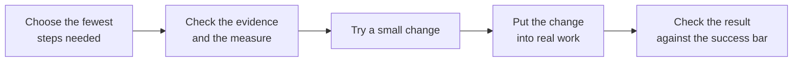

<div align="center">

# stop-firefighting

Why does it keep happening? Find out, and fix it for good.

Problem-solving skills for every common AI agent platform — or any LLM.


Works with Claude Code · Codex · Cursor · Gemini CLI · GitHub Copilot · OpenCode · Windsurf · Hermes — and any agent that reads `SKILL.md`.

</div>

## What it helps with

| You say | What the skill does |
|---|---|
| "The supplier is late again." | Checks which date "late" is counted from and what's on your side, before you switch. |
| "This approval takes a week." | Finds where the week goes — waiting vs work, step by step; never drops a check without naming what replaces it. |
| "Same mistake, every week." | Blame-free review; compares error rates, not counts; looks at steps and changes, not people. |
| "It came back after we fixed it." | Checks whether the earlier fix was really in place before looking for another cause. |
| "Our AI assistant keeps making the same mistake." | Checks what can be observed: a request changed at handover, missing or outdated information, a skipped step, or a check that tests the wrong thing. |
| "Did the change actually work?" | Before/after on the same basis, with charts and a real test, in plain words. |
| "Should I fire her?" | Looks at the work system and the numbers first; never ranks or blames individuals. |
| "Write this up as an SOP." | Writes a procedure from rules you're allowed to use; never invents a rule; marks proposals as not yet adopted. |

## How it works

Use only the steps the situation needs. A single data question gets a direct answer. A problem that came back starts with checking the earlier fix. A change that just went live gets a success bar and a check date.



As needed, the skill covers six responsibilities: name what to fix in your words; check the facts and the measure; trace the cause to something that can change; run a small trial; put the change into real work; and plan for the next occurrence and handover.

It aims to return the thing you need: an analysis, filled table, fixed file, trial plan, or change ready to approve. Then it gives one line on how far it got: **planned / approved / in place / checked / held**. Each status needs evidence. “Be more careful” or “add a reminder” does not close a case.

The same approach covers people, teams, machines, suppliers, software and AI assistants. It reviews observable failures without blame. An optional `problem-notes/` record in your project lets you resume a case across conversations.

## What's inside

- **Method cards, usable on their own:** requirements and boundaries; measure checks; walking the real work and removing steps; cause tracking; small trials and what they could break (severity first, no multiplied risk scores); two-level experiments; control plans and handover; benefits and added burden.
- **Script commands (Python standard library only):** control charts with all eight Nelson rules and before/after phases; capability checks that refuse an unstable process; correlation and regression; rater agreement (kappa); gauge studies; two-level factorial design and analysis; normality tests; decision matrices with weight-change checks; histograms, box plots and scatter plots; path crossings; and the share of lead time spent on actual work.

## Before / after

> Both examples are illustrative and shortened.

**You ask:** "Our supplier is always late. Should I switch?"

**Typical AI answer:** talk to the supplier about expectations, set clearer SLAs and penalties, research backup suppliers, consider switching if it continues.

**With stop-firefighting:** don't decide yet. First — "late" against which date? The date they promised, or the date you needed it? Shipped, or received? Then check your side: were orders placed inside their quoted lead time, or changed after ordering? Fill this for the last 20–50 orders:

| PO | ordered | quoted lead time | needed by | promised | received | changed after PO? | late vs promise | late vs need |
|---|---|---|---|---|---|---|---|---|

Agree the bar for switching *before* you look at the numbers.

## Install

Clone the repo and symlink the two skill folders into your agent's skills directory:

```sh
git clone https://github.com/lucyleeai/stop-firefighting
mkdir -p ~/.agents/skills
ln -s "$PWD/stop-firefighting/problem-solving/skills/problem-solving" ~/.agents/skills/problem-solving
ln -s "$PWD/stop-firefighting/problem-solving/skills/write-sop" ~/.agents/skills/write-sop
```

`~/.agents/skills/` is the shared folder read by Codex, Cursor, Gemini CLI, GitHub Copilot, OpenCode and Windsurf.

| Platform | Where to put the skill folders |
|---|---|
| Claude Code | `claude plugin marketplace add lucyleeai/stop-firefighting` then `claude plugin install stop-firefighting@stop-firefighting` — or copy to `~/.claude/skills/` |
| Codex | `~/.agents/skills/` or `.agents/skills/` in a repo |
| Cursor | `~/.agents/skills/` or `~/.cursor/skills/` |
| Gemini CLI | `~/.agents/skills/` or `~/.gemini/skills/` |
| GitHub Copilot | `~/.agents/skills/` or `~/.copilot/skills/` |
| OpenCode | `~/.agents/skills/` or `~/.config/opencode/skills/` |
| Windsurf | `~/.agents/skills/` or `~/.codeium/windsurf/skills/` |
| Hermes | `~/.hermes/skills/` |
| Any other agent | Its skills folder (see its docs) |
| Any LLM (no skills support) | Give it `SKILL.md` as instructions, point it at the skill folder, and let it run the Python scripts in `scripts/`. |

## Quick start

After installing, describe the problem in your own words to your agent:

- "The kitchen is chaos at dinner rush."
- "Invoices take forever to get paid."
- "我们的审批太慢了"

With a smaller model, name the skill: "Use problem-solving to look at why our orders ship late." Smaller models do not always open it by themselves. When they don't, they work numbers out on their own and can get them wrong.

The `write-sop` skill runs when you ask for it by name — for example, "write an SOP for how we handle returns."

## Why trust the numbers

- Every number — durations, rates, tests, control limits, sample sizes — comes from two bundled Python scripts (standard library only, never the model's own arithmetic). If a script can't run, it says so instead of guessing.
- Every method cites a public source (NIST/SEMATECH e-Handbook, UK HSE, ASQ and others) in `sources.md` files. Wording is original.
- Checked against SciPy and statsmodels: **9,412 comparisons, all matching** (`dev/verify_against_scipy.py`).
- Check the scripts yourself:
  ```sh
  python3 problem-solving/skills/problem-solving/scripts/flow_metrics.py selftest
  python3 problem-solving/skills/problem-solving/scripts/stats_tools.py selftest
  ```

## Status

**v0.2.0.** Issues welcome; outside pull requests not merged for now.

We tested 58 synthetic cases written for this project. They covered everyday work problems such as late suppliers, slow approvals, picking errors and kitchen delays. They also included 12 blind user personas, claims of a status without evidence, and the new methods. No skill, v0.1.0 and v0.2.0 were compared on the same cases.

The main model, gpt-6-sol, had 110 runs per version. Cases where wording matters most were run 3 times. The smaller model, gpt-6-luna, had 30 cases, 1 run each.

A separate model (gpt-6-sol) scored each reply against written checks without knowing which version produced it. Checks on blame and false status used 3 votes. Every run was also checked 3 times for severe failures: blaming a person, a number that contradicts the case data, or a false claim that something was done or solved.

The test agent had general working instructions on stating evidence and not inventing numbers, the same for all three versions. This may make the measured differences smaller, not larger.

| Version | gpt-6-sol: checks passed | gpt-6-luna: checks passed |
|---|---:|---:|
| No skill | 289/364 (79.4%) | 83/109 (76.1%) |
| v0.1.0 | 316/364 (86.8%) | 87/109 (79.8%) |
| v0.2.0 | 325/364 (89.3%) | 95/109 (87.2%) |

With gpt-6-sol, v0.2.0 gained +9.9 percentage points over no skill (95% range across cases: +5.2 to +14.9), a clear gain. Against v0.1.0, it gained +2.5 points (range −0.5 to +5.5), which is not conclusive.

With gpt-6-luna, the gain over no skill was +11.0 points (range +5.0 to +17.3). Against v0.1.0, it was +7.3 points (range −0.9 to +15.5), which is not conclusive. These ranges show uncertainty in the gains; a range that crosses zero leaves open whether there was an improvement.

With v0.2.0, no severe failures were verified in 110 gpt-6-sol runs. The smaller model had one severe failure: a wrong average time. In that run, it did not open the skill or run a bundled script; it worked the number out itself. It opened the skill in 13 of 30 runs with v0.2.0, compared with 7 of 30 with v0.1.0.

The new hand-over case showed no improvement: no skill passed 15/15 checks, v0.1.0 passed 14/15, and v0.2.0 passed 14/15. The base model already handles it.

Treat these results as indicative: the test set is our own. The skill guides and computes, but cannot by itself make an agent load it or enforce a change. It is not a substitute for professional advice on safety-critical, legal or medical decisions.

## License

GNU AGPL-3.0-only. Copyright © 2026 Lucy Lee. See `LICENSE` and `NOTICE`.
