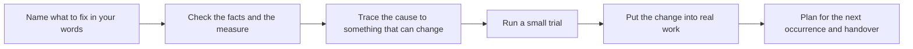

<div align="center">

# stop-firefighting

Find why a problem keeps coming back. Try a small fix and check it holds.

Skills that help your AI agent find causes, try fixes and follow up on results.

  

Tested end to end with Claude Code · Codex · Hermes.

</div>

## What it helps with

| You say | What the skill does |
|---|---|
| "The supplier is late again." | Finds which date "late" is counted from and what's on your side, before you switch. |
| "This approval takes a week." | Finds where the week goes — waiting vs work, step by step; never drops an approval step without naming what replaces it. |
| "Same mistake, every week." | Blame-free review; compares error rates, not counts; looks at steps and changes, not people. |
| "It came back after we fixed it." | Verifies whether the earlier fix was really in place before looking for another cause. |
| "Our AI assistant keeps making the same mistake." | Reviews what can be observed: a request changed at handover, missing or outdated information, a skipped step, or an inspection that tests the wrong thing. |
| "Did the change actually work?" | Before/after on the same basis, with charts and a real test, in plain words. |
| "Should I let the new hire go?" | Looks at the work system and the numbers first; never ranks or blames individuals. |
| "Write this up as an SOP." | Writes a procedure from rules you're allowed to use; never invents a rule; marks proposals as not yet adopted. |

## How it works

Use only the steps the situation needs. A single data question gets a direct answer. A problem that came back starts by verifying that the earlier fix is in place. A change that just went live gets a success bar and a check date.



As needed, the skill covers six responsibilities: name what to fix in your words; check the facts and the measure; trace the cause to something that can change; run a small trial; put the change into real work; and plan for the next occurrence and handover.

It returns the thing you need: an analysis, filled table, fixed file, trial plan, or change ready to approve. Then it gives one line on how far it got: **planned / approved / in place / checked / held**. Each status needs evidence. “Be more careful” or “add a reminder” does not close a case.

The same approach covers people, teams, machines, suppliers, software and AI assistants. It reviews observable failures without blame. An optional `problem-notes/` record in your project lets you resume a case across conversations. The skill guides and computes, but cannot by itself make an agent load it or enforce a change. It is not a substitute for professional advice on safety-critical, legal or medical decisions.

## What's inside

**Method cards, usable on their own:** requirements and boundaries; whether a measure can be trusted; walking the real work and removing steps; cause tracking; small trials and what they could break (severity first, no multiplied risk scores); two-level experiments; control plans and handover; benefits and added burden.

**Script commands (Python standard library only):**

- See whether a number is stable over time and compare periods before and after a change (control charts with all eight Nelson rules). Assess whether a stable process meets its limits (process capability).
- See how numbers vary and relate (histograms, box plots, scatter plots, correlation and regression). Test for a bell-shaped distribution (normality tests).
- See whether people and tools give consistent measurements (rater agreement, kappa and gauge studies). Compare combinations of changes in a trial (two-level factorial design and analysis).
- See whether changing priorities changes a decision (decision matrices). Find where work routes cross (path crossings) and how much time goes to work rather than waiting (share of lead time spent on actual work).

## Before / after

> This example is illustrative and shortened.

**You ask:** "Our supplier is always late. Should I switch?"

**Typical AI answer:** talk to the supplier about expectations, set clearer SLAs and penalties, research backup suppliers, consider switching if it continues.

**With stop-firefighting:** don't decide yet. First — "late" against which date? The date they promised, or the date you needed it? Shipped, or received? Then review your side: were orders placed inside their quoted lead time, or changed after ordering? Fill this for the last 20–50 orders:

| PO | ordered | quoted lead time | needed by | promised | received | changed after PO? | late vs promise | late vs need |
|---|---|---|---|---|---|---|---|---|

Agree the bar for switching *before* you look at the numbers.

## Install

Clone the repo and symlink the two skill folders into your agent's skills directory:

```sh
git clone https://github.com/lucyleeai/stop-firefighting
mkdir -p ~/.agents/skills
ln -s "$PWD/stop-firefighting/problem-solving/skills/problem-solving" ~/.agents/skills/problem-solving
ln -s "$PWD/stop-firefighting/problem-solving/skills/write-sop" ~/.agents/skills/write-sop
```

The commands above install the skills for Codex. Use the folders below for other hosts.

| Platform | Where to put the skill folders |
|---|---|
| Claude Code | `claude plugin marketplace add lucyleeai/stop-firefighting` then `claude plugin install stop-firefighting@stop-firefighting` — or copy to `~/.claude/skills/` |
| Codex | `~/.agents/skills/` or `.agents/skills/` in a repo |
| Hermes | `~/.hermes/skills/` |
| Other agents that read `SKILL.md` | Put the two folders in that agent's skills folder — not tested. |
| Any LLM (no skills support) | Give it `SKILL.md` as instructions, point it at the skill folder, and let it run the Python scripts in `scripts/` — not tested. |

## Quick start

After installing, describe the problem in your own words to your agent:

- "The kitchen is chaos at dinner rush."
- "Invoices take forever to get paid."
- "我们的审批太慢了"

With a smaller model, name the skill: "Use problem-solving to look at why our orders ship late." Smaller models do not always open it by themselves. When they don't, they work numbers out on their own and can get them wrong.

The `write-sop` skill runs when you ask for it by name — for example, "write an SOP for how we handle returns."

## Why trust the numbers

- When the skill is loaded, every calculated number — durations, rates, tests, control limits, sample sizes — comes from two bundled Python scripts (standard library only). If a script cannot run, the agent says so instead of guessing. See [Quick start](#quick-start) for advice on loading the skill with smaller models.
- Every method cites a public source (NIST/SEMATECH e-Handbook, UK HSE, ASQ and others) in `sources.md` files. Wording is original.
- Comparison with SciPy and statsmodels: **9,412 comparisons, all matching** (`dev/verify_against_scipy.py`).
- Run the scripts yourself:
  ```sh
  python3 problem-solving/skills/problem-solving/scripts/flow_metrics.py selftest
  python3 problem-solving/skills/problem-solving/scripts/stats_tools.py selftest
  ```

## Status

Version: 0.2.0<br>
Issues welcome; outside pull requests not merged for now.<br>
See [CHANGELOG.md](CHANGELOG.md) for how it was tested and the results.

## License

GNU AGPL-3.0-only. Copyright © 2026 Lucy Lee. See `LICENSE` and `NOTICE`.
