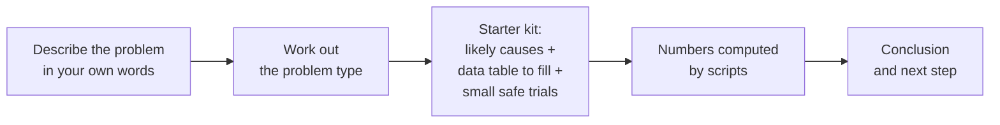

<div align="center">

# stop-firefighting

Why does it keep happening? Find out, and fix it for good.

Problem-solving skills for every common AI agent platform — or any LLM.


Works with Claude Code · Codex · Cursor · Gemini CLI · GitHub Copilot · OpenCode · Windsurf · Hermes — and any agent that reads `SKILL.md`.

</div>

## What it helps with

| You say | What the skill does |
|---|---|
| "The supplier is late again." | Checks which date "late" is counted from and what's on your side, before you switch. |
| "This approval takes a week." | Finds where the week goes — waiting vs work, step by step; never drops a check without naming what replaces it. |
| "Same mistake, every week." | Blame-free review; compares error rates, not counts; looks at steps and changes, not people. |
| "Did the change actually work?" | Before/after on the same basis, with charts and a real test, in plain words. |
| "Should I fire her?" | Looks at the work system and the numbers first; never ranks or blames individuals. |
| "Write this up as an SOP." | Writes a procedure from rules you're allowed to use; never invents a rule; marks proposals as not yet adopted. |

## How it works



## Before / after

> Both examples are illustrative and shortened.

**You ask:** "Our supplier is always late. Should I switch?"

**Typical AI answer:** talk to the supplier about expectations, set clearer SLAs and penalties, research backup suppliers, consider switching if it continues.

**With stop-firefighting:** don't decide yet. First — "late" against which date? The date they promised, or the date you needed it? Shipped, or received? Then check your side: were orders placed inside their quoted lead time, or changed after ordering? Fill this for the last 20–50 orders:

| PO | ordered | quoted lead time | needed by | promised | received | changed after PO? | late vs promise | late vs need |
|---|---|---|---|---|---|---|---|---|

Agree the bar for switching *before* you look at the numbers.

## Install

Clone the repo and symlink the two skill folders into your agent's skills directory:

```sh
git clone https://github.com/lucyleeai/stop-firefighting
mkdir -p ~/.agents/skills
ln -s "$PWD/stop-firefighting/problem-solving/skills/problem-solving" ~/.agents/skills/problem-solving
ln -s "$PWD/stop-firefighting/problem-solving/skills/write-sop" ~/.agents/skills/write-sop
```

`~/.agents/skills/` is the shared folder read by Codex, Cursor, Gemini CLI, GitHub Copilot, OpenCode and Windsurf.

| Platform | Where to put the skill folders |
|---|---|
| Claude Code | `claude plugin marketplace add lucyleeai/stop-firefighting` then `claude plugin install stop-firefighting@stop-firefighting` — or copy to `~/.claude/skills/` |
| Codex | `~/.agents/skills/` or `.agents/skills/` in a repo |
| Cursor | `~/.agents/skills/` or `~/.cursor/skills/` |
| Gemini CLI | `~/.agents/skills/` or `~/.gemini/skills/` |
| GitHub Copilot | `~/.agents/skills/` or `~/.copilot/skills/` |
| OpenCode | `~/.agents/skills/` or `~/.config/opencode/skills/` |
| Windsurf | `~/.agents/skills/` or `~/.codeium/windsurf/skills/` |
| Hermes | `~/.hermes/skills/` |
| Any other agent | Its skills folder (see its docs) |
| Any LLM (no skills support) | Give it `SKILL.md` as instructions, point it at the skill folder, and let it run the Python scripts in `scripts/`. |

## Quick start

After installing, describe the problem in your own words to your agent:

- "The kitchen is chaos at dinner rush."
- "Invoices take forever to get paid."
- "我们的审批太慢了"

The `write-sop` skill runs when you ask for it by name — for example, "write an SOP for how we handle returns."

## Why trust the numbers

- Every number — durations, rates, tests, control limits, sample sizes — comes from two bundled Python scripts (standard library only, never the model's own arithmetic). If a script can't run, it says so instead of guessing.
- Every method cites a public source (NIST/SEMATECH e-Handbook, UK HSE, ASQ and others) in `sources.md` files. Wording is original.
- Check the scripts yourself:
  ```sh
  python3 problem-solving/skills/problem-solving/scripts/flow_metrics.py selftest
  python3 problem-solving/skills/problem-solving/scripts/stats_tools.py selftest
  ```

## Status

Early release (v0.1.0). Issues welcome; outside pull requests not merged for now. Not a substitute for professional advice on safety-critical, legal or medical decisions.

## License

GNU AGPL-3.0-only. Copyright © 2026 Lucy Lee. See `LICENSE` and `NOTICE`.
